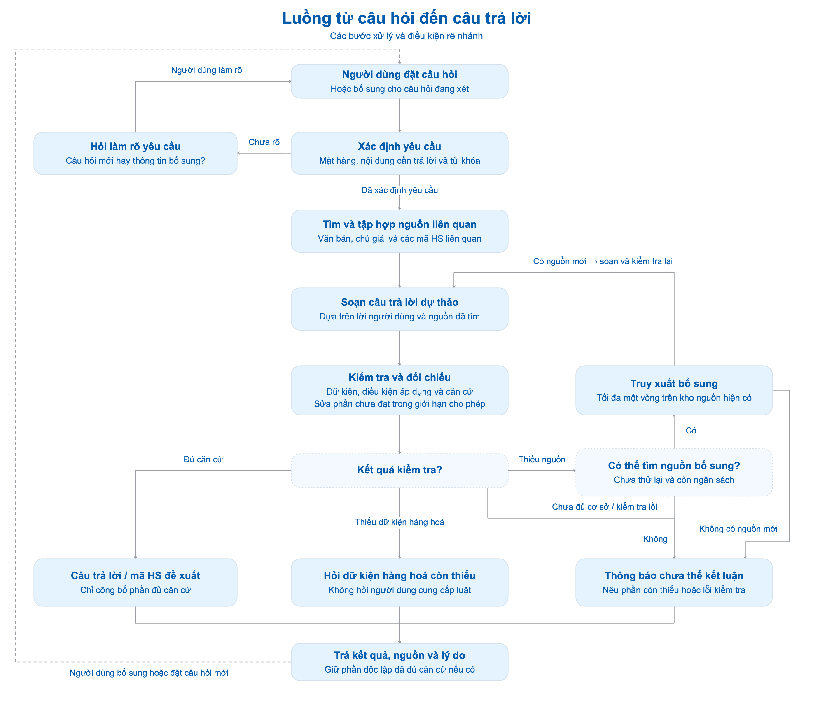

# Luồng từ câu hỏi đến câu trả lời

Sơ đồ mô tả luồng chính ở mức tổng quan. Các kiểm tra kỹ thuật, review và sửa phần chưa đạt được gom vào bước **Kiểm tra và đối chiếu** để dễ theo dõi đường đi của câu hỏi.

## Các bước chính

1. **Nhận câu hỏi:** người dùng đặt câu hỏi mới hoặc bổ sung thông tin cho câu hỏi đang xét.
2. **Xác định yêu cầu:** nhận diện mặt hàng, nội dung cần trả lời và từ khóa tìm kiếm. Nếu chưa rõ đây là câu hỏi mới hay thông tin bổ sung, hỏi người dùng làm rõ trước khi tiếp tục.
3. **Tìm và tập hợp nguồn:** truy xuất văn bản, chú giải và các mã HS liên quan để làm căn cứ trả lời.
4. **Soạn dự thảo:** AI xây dựng câu trả lời từ lời người dùng và nguồn đã tìm; chưa công bố ngay.
5. **Kiểm tra và đối chiếu:** kiểm tra dữ kiện, điều kiện áp dụng và căn cứ của nội dung; sửa phần chưa đạt trong giới hạn cho phép.
6. **Trả kết quả:** công bố phần đủ căn cứ, câu hỏi bổ sung hoặc lý do chưa thể kết luận, kèm nguồn tương ứng.

## Điều kiện rẽ nhánh

- **Đủ căn cứ:** trả lời nội dung được hỏi hoặc đưa ra mã HS đề xuất ở cấp yêu cầu.
- **Thiếu dữ kiện hàng hoá:** hỏi đúng thông tin còn thiếu. Khi người dùng bổ sung, quay lại xác định yêu cầu và tìm nguồn.
- **Thiếu chứng cứ pháp lý:** nếu gap đủ điều kiện, chưa truy xuất bổ sung và còn ngân sách, thử tìm thêm nguồn tối đa một vòng. Có nguồn mới thì soạn và kiểm tra lại; không có nguồn mới hoặc không thể tìm tiếp thì nêu phần còn thiếu.
- **Chưa đủ cơ sở hoặc kiểm tra không hoàn tất hợp lệ:** thông báo chưa thể kết luận, nêu lý do hoặc lỗi kiểm tra; không tự đưa ra mã HS chưa được hỗ trợ.

Các nhánh được xét theo từng nội dung trong yêu cầu: một lượt có thể vừa trả lời phần đủ căn cứ, vừa hỏi bổ sung hoặc nêu hạn chế ở phần khác. Thiếu luật là vấn đề tìm nguồn của hệ thống, không yêu cầu người dùng cung cấp luật. Câu hỏi mới bắt đầu ngữ cảnh riêng.

[Nguồn Mermaid của sơ đồ](generationFlow.mmd)
