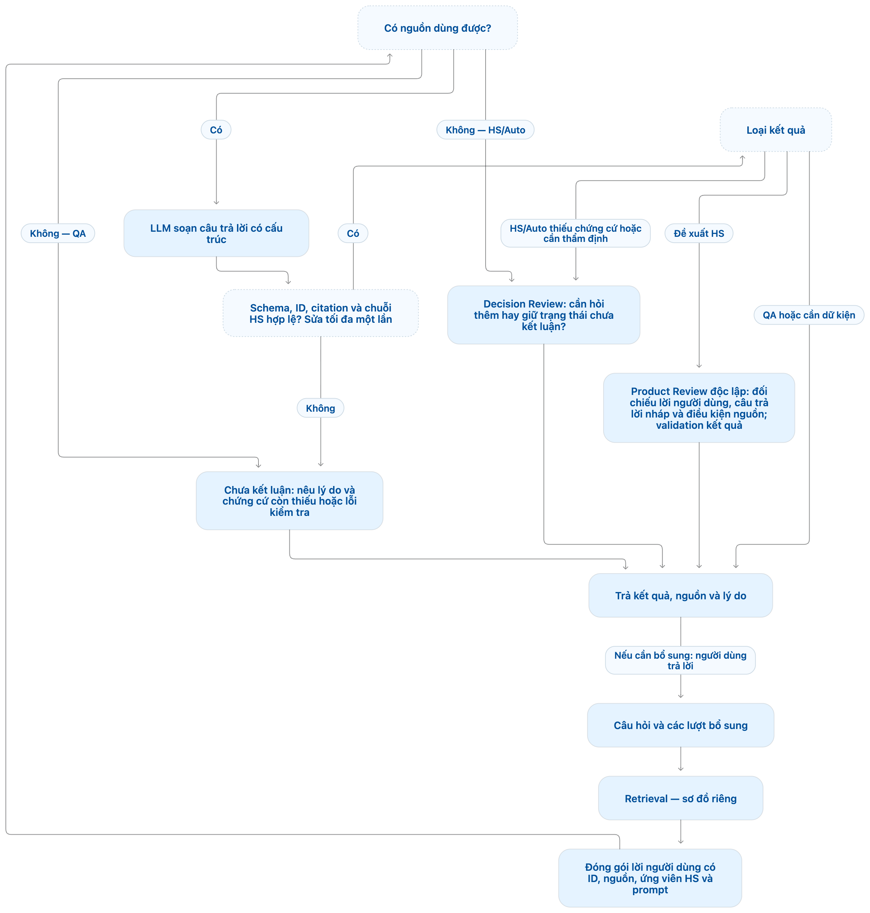
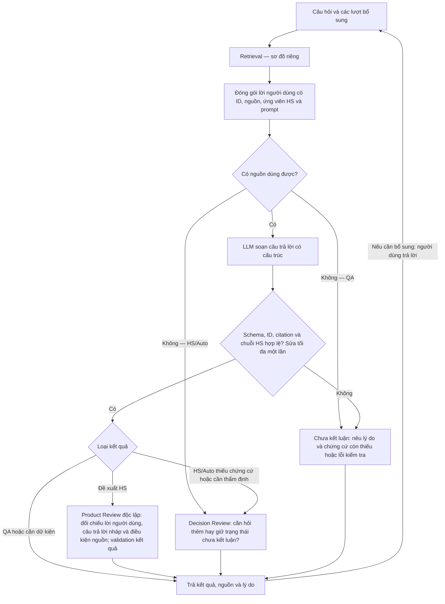

# Luồng từ câu hỏi đến câu trả lời

Sơ đồ mô tả **RAG Demo đang dùng Auto** và contract `registry-v2`. Auto để model nhận biết câu hỏi cần phân loại HS, hỏi đáp kiến thức (QA) hay kết hợp cả hai; không có nghĩa luôn xử lý cả hai nội dung. Retrieval được gom thành một khối vì đã có sơ đồ riêng.

Điểm rẽ nhánh là **trạng thái có cấu trúc mà model trả về sau validation**, không phải hệ thống đọc các câu như “chưa đủ thông tin” rồi tự đoán luồng. “Thiếu dữ kiện người dùng” và “thiếu chứng cứ pháp lý của hệ thống” dẫn đến các bước khác nhau.

## Sơ đồ

**Chú thích để đọc sơ đồ cũ:**

- **“Không — HS/Auto” / “Không — QA”:** “Không” nghĩa là không có nguồn dùng được. Auto là tự nhận biết nhu cầu HS, QA hoặc kết hợp, không phải luôn làm cả hai. Demo hiện dùng Auto; nhãn QA riêng áp dụng khi caller cố định tác vụ QA.
- **“Validation hợp lệ? Sửa tối đa một lần”:** kiểm tra bằng code về cấu trúc, ID, citation và các ràng buộc phát hành mã. Nếu lỗi thì sửa bản nháp một lần rồi kiểm tra lại; vẫn lỗi thì không phát hành mã. Đây chưa phải đánh giá đầy đủ ngữ nghĩa.
- **“QA hoặc cần dữ kiện”:** hai trường hợp riêng được gộp trên cùng đường nối: `ANSWERED` là đã trả lời được QA; `MISSING_PRODUCT_INFO` là đã có câu hỏi bổ sung cụ thể. Cả hai được trả trực tiếp sau validation, không qua Decision Review ở nhánh này.
- **“HS/Auto thiếu chứng cứ hoặc cần thẩm định”:** bản nháp trả `INSUFFICIENT_LEGAL_EVIDENCE` hoặc `REQUIRES_REVIEW`, nên qua Decision Review để kiểm tra nên giữ kết quả chưa kết luận hay chuyển sang câu hỏi bổ sung.
- **Vòng lặp quay lại câu hỏi:** chỉ khi cần bổ sung dữ kiện và người dùng trả lời, hệ thống ghép thông tin mới với câu hỏi ban đầu rồi chạy Retrieval lại. Đây là vòng hội thoại; khác với lượt sửa bản nháp khi validation lỗi.

Nguồn Mermaid của luồng tổng quát

## Model trả gì thì đi nhánh nào?

Các trường hợp dưới đây áp dụng khi bản nháp đã vượt qua validation. Đây là trạng thái **model khai báo**, chưa mặc định là kết luận đúng về ngữ nghĩa.

| `answer.status` | Model đang khai báo điều gì? | Điều kiện cấu trúc quan trọng | Bước kế tiếp trong Demo Auto |
|---|---|---|---|
| `RECOMMENDATION` | Đã chọn một mã HS đề xuất | Có mã HS8 thuộc danh sách ứng viên, đủ citation bắt buộc và chuỗi HS đã xác minh | Product Review kiểm tra độc lập trước khi phát hành |
| `ANSWERED` | Đã trả lời được phần hỏi đáp kiến thức | Có nguồn trích dẫn hợp lệ; không kèm mã đề xuất | Trả câu trả lời QA; không qua Product Review hoặc Decision Review |
| `MISSING_PRODUCT_INFO` | Đã nêu rõ dữ kiện cần hỏi người dùng | Có câu hỏi cụ thể trong `clarifications`; thuộc tính quyết định phải gắn ID điều kiện nguồn, trừ nhận diện đối tượng/phạm vi | Trả câu hỏi bổ sung trực tiếp; không qua Decision Review ở nhánh này |
| `INSUFFICIENT_LEGAL_EVIDENCE` | Ngữ cảnh chưa có chứng cứ pháp lý cần để kết luận | Có `missing_legal_evidence`, mã đề xuất rỗng, không hỏi người dùng cung cấp luật | Decision Review kiểm tra lại lý do chưa kết luận |
| `REQUIRES_REVIEW` | Chưa phân định được việc áp dụng nguồn hoặc cần kiểm tra thêm | Không phát hành mã HS hoặc hỏi bổ sung dưới trạng thái này | Decision Review kiểm tra lại lý do chưa kết luận |

**Vì sao tách “đã có câu hỏi bổ sung” khỏi “thiếu chứng cứ/cần thẩm định”?** Ở trường hợp đầu, model đã trả câu hỏi cụ thể và hệ thống chuyển câu hỏi đó đến người dùng. Ở trường hợp sau, model mới dừng ở quyết định chưa kết luận; Decision Review kiểm tra xem nên giữ quyết định ấy hay thực ra cần hỏi dữ kiện hàng hóa. Sơ đồ giữ nhãn gộp “QA hoặc cần dữ kiện” để giữ bố cục cũ; cần đọc đó là hai trường hợp riêng, không phải “QA đang thiếu dữ kiện”.

Câu hỏi bổ sung đi thẳng sau validation là **hành vi hiện tại**, không có nghĩa đã được một model độc lập xác nhận rằng câu hỏi ấy cần thiết. Backend kiểm tra nguồn gốc, cấu trúc, quyền sở hữu thông tin và một số ràng buộc số đo; nó chưa chứng minh toàn bộ ý nghĩa câu hỏi đúng.

## Validation và “sửa tối đa một lần”

Validation của bản nháp chạy bằng code, gồm schema, ID lời người dùng/nguồn, citation, quyền sở hữu dữ kiện/pháp lý, các chốt số đo hỗ trợ và điều kiện phát hành mã HS như danh sách ứng viên/chuỗi phân cấp. Nó rộng hơn kiểm tra cú pháp nhưng không thay thế đánh giá ngữ nghĩa.

Nếu lỗi, hệ thống gửi danh sách lỗi cho model sửa **một lần**, rồi validation lại. Tính cả lần đầu là tối đa hai bản nháp. Vẫn lỗi thì không phát hành mã: trả kết quả an toàn cùng chẩn đoán. Trường hợp bị chặn bởi validation không được chuyển sang Decision Review chỉ vì kết quả an toàn có trạng thái thiếu chứng cứ/cần thẩm định.

Product Review và Decision Review có vòng kiểm tra riêng; mỗi vòng cũng có tối đa một lượt sửa kết quả review. Đó là các lượt khác với lượt sửa bản nháp.

## Product Review trả gì?

Bước này chỉ chạy sau bản nháp `RECOMMENDATION` hợp lệ. Nó nhận câu trả lời nháp, toàn bộ lời người dùng, ứng viên và các nguồn liên quan để đối chiếu ngữ nghĩa. Không mặc định mã được đề xuất là đúng.

| Kết quả review đã hợp lệ | Kết quả trả ra |
|---|---|
| `SUPPORTED` | Giữ và phát hành `RECOMMENDATION` có nguồn |
| `MISSING_PRODUCT_INFO` | Chuyển thành câu hỏi bổ sung dữ kiện cụ thể; bỏ mã đề xuất |
| `INSUFFICIENT_LEGAL_EVIDENCE` | Báo chứng cứ hệ thống còn thiếu; bỏ mã đề xuất |
| `REQUIRES_REVIEW` | Nêu điều kiện bị bác bỏ/cách áp dụng chưa phân định; không phát hành mã |
| Review lỗi, không hoàn tất hoặc vẫn không hợp lệ sau lượt sửa | Kết quả an toàn `REQUIRES_REVIEW`, kèm chẩn đoán lỗi; không coi lỗi kỹ thuật là người dùng thiếu dữ kiện |

`user_quotes` phải nằm trong đúng ID lời người dùng được tham chiếu; citation pháp lý được dựng từ ID nguồn. Số đo/đơn vị có guard dùng chung. Việc nội dung trích dẫn có thật sự chứng minh đầy đủ điều kiện vẫn cần đánh giá ngữ nghĩa.

Nếu Product Review chuyển đề xuất thành trạng thái khác, lượt đó không chạy thêm Decision Review chỉ vì trạng thái mới là thiếu chứng cứ/cần thẩm định.

## Decision Review trả gì?

Trong Demo Auto, bước này chạy khi không có nguồn dùng được, hoặc bản nháp hợp lệ báo `INSUFFICIENT_LEGAL_EVIDENCE`/`REQUIRES_REVIEW`. Khi không có nguồn, bản nháp sinh bởi LLM được bỏ qua; hệ thống tạo trạng thái thiếu chứng cứ ban đầu rồi kiểm tra nhu cầu người dùng.

| Quyết định review đã hợp lệ | Khi nào dùng? | Kết quả trả ra |
|---|---|---|
| `CLARIFY` | Đối tượng/phạm vi chưa rõ, hoặc có dữ kiện hàng hóa quyết định còn thiếu với căn cứ phù hợp | `MISSING_PRODUCT_INFO`, có câu hỏi cụ thể; không phát hành mã |
| `KEEP` | Giữ quyết định chưa kết luận, không thêm yêu cầu hỏi người dùng | Giữ trạng thái `INSUFFICIENT_LEGAL_EVIDENCE` hoặc `REQUIRES_REVIEW` ban đầu |
| Review lỗi, không hoàn tất hoặc vẫn không hợp lệ sau lượt sửa | Chưa thể tin cậy kết quả kiểm tra | `REQUIRES_REVIEW` cùng chẩn đoán kỹ thuật; không tự tạo câu hỏi |

Decision Review không thể tự phát hành đề xuất HS. Với yêu cầu kết hợp, khi cần hỏi bổ sung, nó có thể giữ phần QA độc lập đã có nguồn.

## Ngữ cảnh, nguồn và các giới hạn

- `user_context.statements` chỉ giữ lời con người, thứ tự lượt và ID nguồn gốc; không tự gán loại hàng, thuộc tính, trạng thái xác nhận hay thông số mặc định. Phản hồi AI trước và từ khóa mở rộng truy vấn không trở thành dữ kiện người dùng.
- Bộ đóng gói đưa lời người dùng, nguồn có định vị, ứng viên, chứng cứ chuỗi HS và prompt vào ngân sách model; không cắt âm thầm điều kiện pháp lý.
- Thiếu dữ kiện có thể hỏi người dùng; thiếu luật/GIR/Chú giải là việc của retrieval/corpus. Thiếu nguồn ở lượt này không chứng minh toàn kho dữ liệu không có nguồn đó.
- `/new` bắt đầu câu hỏi mới; `/retry` chạy lại cùng dữ kiện; `/model` đổi model. Phản hồi bổ sung được ghép vào ngữ cảnh rồi truy xuất lại.
- API cấp thấp có thể được gọi với `task=qa` hoặc `task=hs`. Nếu caller cố định `task=qa`, không có nguồn thì báo thiếu chứng cứ mà không gọi Decision Review; bản nháp QA chưa kết luận cũng không qua Decision Review. Đây là khác biệt của caller, không phải một lựa chọn chế độ người dùng phải thao tác trong Demo Auto.
- Không còn cấu hình hãng/dòng sản phẩm, parser Product Fact hoặc enum thuộc tính theo danh mục. `clarifications.attribute` nhận tên thuộc tính mở từ điều kiện nguồn. Các chốt citation, chuỗi HS và số đo dùng chung không chứa ánh xạ loại hàng → mã HS.
- Cấu trúc/nguồn gốc hợp lệ và các review bằng model không chứng minh mã HS chắc chắn đúng pháp lý; nhận diện, ý nghĩa dữ kiện, mâu thuẫn và đính chính vẫn cần đánh giá ngữ nghĩa.

## Đối chiếu triển khai và dựng lại ảnh

Điều kiện rẽ nhánh nằm ở `rag/llm/answering.py::generate_answer`; việc giải mã kết quả Decision Review nằm ở `rag/llm/decision_review.py::_checked_decision`. Các ràng buộc đầu ra nằm ở `rag/llm/validation.py` và `rag/llm/evidence.py`.

Ảnh `generationFlow.png` giữ nguyên bố cục bản cũ và vòng lặp hội thoại. Khối Mermaid mô tả cùng luồng tổng quát; các chú thích và bảng trạng thái giải thích điều kiện rẽ nhánh mà không thêm ô hoặc đường nối vào ảnh.
