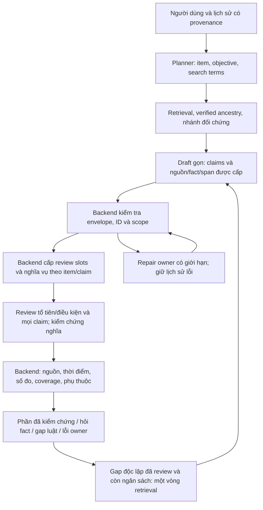
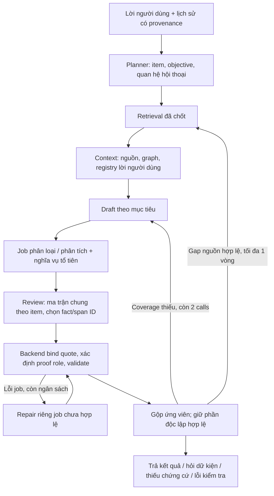
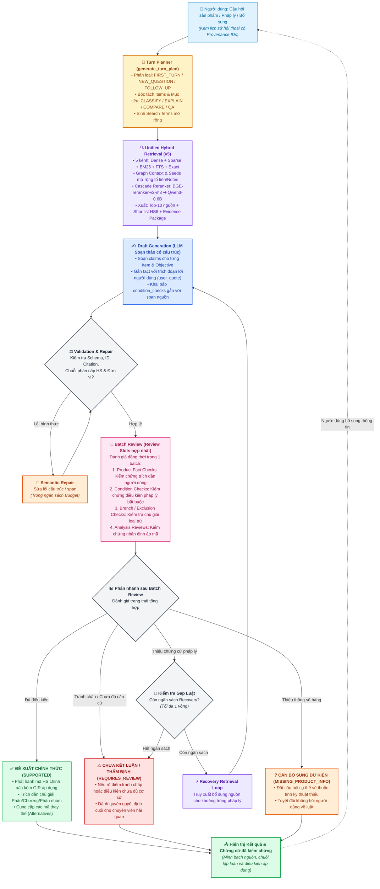
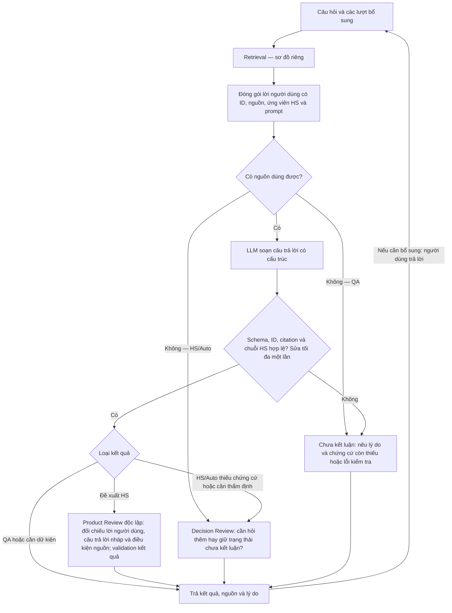

# Luồng từ câu hỏi đến câu trả lời

## Cập nhật semantic-v1 — 22/10/2026

`reasoning_contract=semantic-v1` tách đúng ID/quote khỏi semantic entailment. Draft chưa
được công khai và không phải tự dựng proof graph. Review đọc toàn bộ statement và
điều kiện nguồn; câu hỏi, giả định, phủ định và đính chính được xét trước khi dùng fact.
Cả claim của CLASSIFY đề xuất cũng có analysis review; kết quả quyết định và claim
cùng owner phải đều hợp lệ. COMPARE có nội dung áp mã chịu phụ thuộc từng item;
REFERENCE độc lập đã kiểm chứng được giữ khi phần áp dụng bị chặn.

Các mục proof graph/ledger bên dưới mô tả đường registry/canonical lịch sử. Primitive
proof engine vẫn kiểm tra hình thức và tổng hợp logic; không được coi PROVEN tự khai
là bằng chứng ngữ nghĩa. Chốt số đo, ancestry, source/span, độ phủ và fail-closed vẫn giữ.
Transport retry không tiêu ngân sách semantic repair; cấu hình model/provider/corpus
không thay trong chuyển đổi này. Kết quả regression thực đo ghi trong `artifacts/obligation-flow-20261022/report.md`.
SOURCE_SNAPSHOT trả lời theo wording và công khai việc chưa xác minh hiệu lực hiện hành;
CURRENT_APPLICABILITY/as_of kiểm tra metadata thời điểm, không nâng UNVERIFIED thành CURRENT.
Các condition check dùng mảng với số lượng/ID backend cấp; thiếu/lặp/thay nguồn bị từ chối.
Áp mã dùng binding từng item, không hợp các mã của mọi mặt hàng làm cùng miền chấp nhận.
Chốt số vẫn fail-closed nếu claim nhiều mặt hàng chưa có đối chiếu predicate riêng.

## Contract hiện tại: goals-v1

Khi planner trả `request` hợp lệ, cùng một request LLM nhận diện quan hệ hội thoại, mặt hàng và mục tiêu trước retrieval. `CLASSIFY` xác định cấp HS4/6/8 được hỏi; `EXPLAIN`, `REQUIREMENTS` và mục tiêu khác giữ đúng phạm vi riêng. Mỗi mặt hàng có ID/anchor nguyên văn; từ khóa mở rộng chỉ phục vụ tìm nguồn. Câu hỏi mới không kế thừa thuộc tính của mặt hàng trước.

Context `goals-v1` đưa mục tiêu, lời người dùng và catalogue mã/nguồn đã kiểm tra vào generation. Kết quả có từng objective/item; backend kiểm tra đúng cấp yêu cầu, độ phủ, nguồn, trích đoạn và chuỗi `CONTAINS`. Không mặc định mọi câu hỏi phải trả HS8. `registry-v2` vẫn phục vụ caller không có request theo mục tiêu và replay context cũ; đây là đường tương thích giao thức, không phải cơ chế đổi provider.

Một batch Product Review kiểm tra các đề xuất/ứng viên và `analysis_jobs` nếu cần rà soát nhận định áp dụng pháp luật. Các job phân tích dùng schema tại `rag/prompts/generation/task_answering.py`; `task_review_prompt()` chỉ đưa phần chỉ dẫn tương ứng loại job đang có; không có lượt LLM riêng chỉ để đọc một `ANALYSIS_PROMPT`. Cả giao thức đơn và batch dùng chung `EVIDENCE_POLICY` và `REVIEW_POLICY`. Chỉ trạng thái `SUPPORTED` đòi hỏi toàn bộ điều kiện bắt buộc `SATISFIED`; trạng thái thiếu dữ kiện vẫn phải khai báo đủ điều kiện để chỉ ra phần thiếu.

## Ứng viên và thuộc tính còn thiếu

### Kiểm chứng bổ sung sau audit 20/10

Batch kiểm tra cả `PRODUCT_FACT` trong các job giải thích/chưa kết luận. `FACT_SUPPORTED`
cần `fact_ids` của chính claim và trích đoạn người dùng có thật; backend xuất những
trích đoạn này thay cho lời diễn giải dữ kiện chưa được chứng minh. `FACT_UNSUPPORTED`
hoặc một đánh giá pháp lý dùng sai cho dữ kiện bị chặn. Registry ID không tự chứng minh
quan hệ ngữ nghĩa giữa claim và lời người dùng. Phản hồi ứng viên phân loại vẫn qua
Product Review hiện có; không thêm một pha model riêng cho dữ kiện.

`validation.review_coverage` ghi từng result: `CLAIMS`, `PRODUCT_DECISION` hoặc `NONE`.
Chỉ `CLAIMS` liệt kê các chỉ số claim đã kiểm tra. `semantic_grounding` có thể là
`PARTIALLY_REVIEWED`; các nhãn này mô tả việc kiểm tra, không xác nhận đúng pháp lý.
Nguồn gửi vào review giữ locator, trạng thái pháp lý và khoảng hiệu lực nếu có;
các trường trống vẫn là chưa biết, không suy hiệu lực từ thời gian hay thứ hạng.
`application_level` chỉ yêu cầu cấp mã ở nhận định áp dụng đang bị tranh chấp hoặc
chưa được hỗ trợ; không dùng metadata này để đòi nguồn mã HS cho giải thích quy tắc
chung đã hợp lệ. Claim chứa ID registry E/U thô bị từ chối trước khi hiển thị,
kể cả ID nằm ngoài dấu ngoặc vuông; citation công khai do backend dựng.

`criterion_quote` của condition/branch check và câu hỏi gắn với một span nguyên văn
duy nhất trong nguồn. Backend tạo ID `P...` từ evidence ID và offset, lưu
`condition_bindings` để truy vết. Khi hai phía có mệnh đề, liên kết dựa trên span thay
vì tên `attribute` tự đặt. Nguồn cũ không có quote giữ đường tương thích `D...`;
wire batch mới chọn `condition_id`/`condition_ids` từ danh sách span backend cấp trước; backend dựng lại quote. Registry hiện chứa toàn nguồn và các dòng không trùng, tối đa 33 span/nguồn. Không tự tiếp nhận span ngoài registry. Đây là định danh mệnh đề được trích, chưa phải bộ phân tích
tổng quát AND/OR/ngoại lệ; reviewer vẫn phải kiểm tra logic và phạm vi của toàn nguồn.
`criterion_quotes` có thể dẫn nhiều mệnh đề lựa chọn cho cùng một thuộc tính thực tế,
để một câu hỏi có thể đối chiếu các nhánh giá trị mà không hỏi lặp. Không gộp các
thuộc tính độc lập chỉ vì chúng cùng một nguồn hoặc cùng cấp HS.

Planner kiểm kê các yêu cầu tường minh về phân loại trong anchor của EXPLAIN/COMPARE.
Nếu đã yêu cầu đề xuất phân loại cho các mặt hàng nhưng chưa có CLASSIFY tương ứng,
backend bổ sung mục tiêu đúng phạm vi và cấp yêu cầu. Không quét yêu cầu cũ ngoài các
anchor đang hoạt động để tự thêm mục tiêu; so sánh quy định thuần túy không tạo CLASSIFY.
Câu hỏi về quyền lựa chọn phương pháp phân loại được giữ ở EXPLAIN cấp 0 khi không
yêu cầu mã cụ thể. Guard xét ngữ cảnh cùng câu, tránh dùng câu thủ tục trước đó để
đổi một yêu cầu phân loại thực sự ở câu sau. Đây là kiểm tra ý định hữu hạn.

Mỗi mục tiêu phân loại có thể đề xuất tối đa ba mã có nguồn để kiểm tra; không ép đủ ba mã. Mã được phát hành trong `hs_candidates` phải qua review riêng trong batch. `SUPPORTED` đứng trước ứng viên còn điều kiện. Trong nhóm còn điều kiện, chỉ ưu tiên khi tập điều kiện thiếu có thể so sánh và ít hơn theo quan hệ bao hàm; những trường hợp không đủ cơ sở so sánh giữ đồng hạng. `rank`, `evidence_status` và `ranking_basis` mô tả căn cứ xếp thứ tự, không phải xác suất đúng hay confidence đã hiệu chuẩn.

Backend lấy mã đối chứng qua graph đã xác minh, tối đa thêm 160 mã; giới hạn này không xác nhận đã phủ toàn biểu thuế. Nhánh còn khả năng phù hợp không được tự loại vì thứ hạng. Nếu thuộc tính chưa biết thực sự phân biệt các mã, hỏi đúng thuộc tính ấy và gắn điều kiện nguồn; không giả định từ tên thương mại. Thiếu chứng cứ pháp lý thuộc trách nhiệm retrieval/corpus, không hỏi người dùng cung cấp luật. Phần giải thích hoặc cấp tổng quát đã đủ căn cứ có thể được giữ khi phần áp mã chi tiết bị chặn.

## Recovery, repair và ngân sách

Khi có gap nguồn hợp lệ, recovery chỉ tìm lại trong corpus hiện có, tối đa một vòng. Anchor/codes phải có trong câu hỏi hoặc nguồn và khoảng trống phải thuộc mục tiêu đang xét. Recovery không tạo văn bản pháp lý mới. Kết quả bổ sung được đóng gói và kiểm tra lại, đồng thời giữ phần độc lập đã hợp lệ khi phù hợp.

Generation, review và repair dùng chung ngân sách tối đa năm request ứng dụng cho một lượt xử lý `goals-v1`, bao gồm vòng recovery; không bao gồm request planner hoặc xử lý retry ở tầng transport. Mỗi pha được sửa tối đa một lần trong phần ngân sách còn lại. Recovery cần còn ít nhất hai request để có thể sinh và review. Thông thường một bản nháp và một batch review dùng hai request sau planner; có thể ít hơn nếu không cần review, hoặc nhiều hơn khi repair/recovery.

Lỗi validator là dữ liệu `repair_errors` có `code`, `path`, `message`; chỉ dẫn sửa nằm tại `rag/prompts/core/repair.py`. Không dùng lỗi kỹ thuật để tự kết luận người dùng thiếu thuộc tính hoặc thiếu luật. Client mặc định chỉ gọi model đang chọn xuyên planner, generation, review, repair và recovery; cờ bật fallback tại từng request không thể mở lại chính sách phiên. Chuỗi dự phòng chỉ hoạt động nếu caller chủ động bật ở constructor; xem [cấu hình](../../config/README.md).

Guard định lượng tiếp tục là chốt bảo thủ; các heuristic sản phẩm cũ đã chuyển sang tests/support để đối chiếu, không phải bộ suy luận thuộc tính tổng quát. Kiểm thử phần mềm và nguồn gốc hợp lệ không chứng minh độ đúng pháp lý; đánh giá ngữ nghĩa bằng model và bộ test nghiệp vụ vẫn cần đo riêng.

Khi review REQUIREMENTS phát hiện `OMITTED` nhưng nguồn đã có, hệ thống có thể dành
hai request còn lại cho một lần sửa draft và review phần thay đổi. Các draft/result
độc lập đã hợp lệ được giữ; reviewer không được giả sửa claim chỉ đọc. Cơ chế này vẫn
nằm trong tổng ngân sách năm request, không lặp đến khi model trả đúng.
Review thiếu bản ghi coverage vẫn là lỗi contract kỹ thuật. Nếu repair review không
khắc phục được, backend đánh dấu `UNVERIFIED` và có thể kích hoạt revision đúng mục tiêu
bằng hai request còn lại. Chỉ review mới hợp lệ mới thay thế lỗi cũ; hết ngân sách vẫn
chặn kết luận chưa được kiểm tra.

Giữ kết quả sau recovery chỉ dành cho lỗi kỹ thuật có đánh dấu rõ, khi câu hỏi,
request, snapshot và tập chứng cứ/hiệu lực không thay đổi. Kết quả phụ thuộc vào mục
tiêu chưa hoàn tất không được khôi phục. Khi có nguồn mới hoặc review mới chủ động
hạ trạng thái vì thiếu chứng cứ/phạm vi/coverage, kết luận cũ phải được kiểm tra lại;
việc citation cũ còn tồn tại không đủ để phát hành lại mã.

## Snapshot contract/wire ngày 21/10 (lịch sử)

Các đoạn graph/ledger trong mục này ghi lại trạng thái trước semantic-v1. Không dùng
chúng làm yêu cầu Draft cho goals hiện tại; luồng đầu tài liệu và artifact triển khai
22/10 là phần thay thế. Các sơ đồ cũ phía dưới được giữ để đối chiếu lịch sử.

### Contract quyết định và wire review cập nhật 21/10

Luồng retrieval, corpus, reranking và cấu hình tìm kiếm giữ nguyên. Sau draft,
backend thêm nghĩa vụ kiểm tra tổ tiên từ graph ngay cả khi người dùng chỉ hỏi HS8.
Reviewer đối chiếu proof cho các điều kiện tổ tiên; backend tổng hợp trạng thái trước
khi mở descendants. Probe nội bộ chọn các mức VERIFIED thực sự phân kỳ trong context,
kể cả nhiều HS4, giữ wording và nghĩa vụ kiểm tra phạm vi Chú giải/điều kiện liên quan.
Chỉ cha SUPPORTED qua validator mới thu hẹp hậu duệ. Mã tổ tiên không thay mục tiêu
ban đầu. Nhánh chưa xác minh không bị âm thầm bỏ khỏi so sánh để làm kết luận duy nhất.
Model vẫn chịu trách nhiệm xác định đúng nghĩa và độ đầy đủ của điều kiện nguồn.

Mỗi condition check có `proof_role` và `target_codes` do backend xác định.
`APPLICABILITY` phải thỏa điều kiện mã đang xét; `EXCLUSION` là phản chứng cho mã
đối chiếu, không làm mã đang xét thất bại. Một nguồn bắt buộc của chính mã đang xét
không thể đổi vai trò thành EXCLUSION để lách kiểm tra. `REJECTED` là trạng thái
**nội bộ của ứng viên**, cần RULED_OUT và phản chứng có fact/nguồn hợp lệ. Nó không
phải lỗi toàn nhiệm vụ, không cho phép bỏ qua đối thủ chưa được đánh giá hợp lệ.

Các job cùng mặt hàng, cùng scope và tập fact dùng một `comparison_contexts`/ma trận
`comparison_reviews`; condition review của từng mã vẫn riêng. Không dùng chung ma
trận giữa hai mặt hàng. Model chọn fact ID; backend dựng lời người dùng từ registry.
Wire review giữ object theo job/claim/coverage được giao. Ma trận trả
candidate_group_assessments; mỗi mã xuất hiện đúng một lần. Chứng minh dùng chung
phải có cùng predicate/scope và decisive evidence thuộc miền bắt buộc của mọi thành
viên. Backend mở về từng slot mã và kiểm tra lại; không cắt đối thủ theo Top-K.
proof_catalogue định nghĩa graph một lần, các vị trí dùng proof_key/reason_proof_key.
N/G ID và ledger L ID do backend gán. Thiếu slot/graph giữ phần phụ thuộc UNREVIEWED.
Cả draft và review chọn span ID; backend dựng quote nguồn và kiểm tra quan hệ ID–nguồn–scope. Registry span được tính vào ngân sách đóng gói context.
Danh sách `product_fact_ids` loại những statement chứa nội dung pháp lý theo cùng guard
đang dùng trong validator; statement gốc vẫn giữ để truy vết. Đây là bộ lọc lựa chọn,
không xác minh tính đúng của fact, không tự cắt quote hoặc xác định supersession.
Quote legacy được cung cấp tường minh vẫn phải đúng; không tự thay quote sai để cho
qua validator. ID/quote thật chỉ chứng minh provenance, không tự chứng minh entailment.

Provider ghi `request_contract` gồm effective schema, hash và mode native/wrapper;
JSON wrapper nhận cùng wire schema. Diagnostic gồm code/path/cause/owner/safe_action,
không tự chuyển lỗi chưa chứng minh thành thiếu fact hay thiếu luật. Timeout và lỗi
kết nối có mã transport riêng để phân biệt với HTTP 503 thật.

Repair chỉ gửi lại các job chưa hợp lệ và schema tương ứng, không nối nguyên phản
hồi lỗi trước vào messages. Nguồn của batch ban đầu hiện vẫn giữ trong repair; chưa
có cắt nguồn tối thiểu theo từng job lỗi. Kết quả độc lập đã kiểm tra được giữ lại.

`validation.output_contract_valid` mô tả output sau bảo vệ;
`validation.review_execution_status` cho biết COMPLETED/FAILED ở quá trình kiểm tra;
`task_completion` cho biết đã hoàn thành mục tiêu. Các trạng thái nghiệp vụ vẫn
nằm ở từng result. CLI báo rõ lỗi kiểm tra kỹ thuật và chuyển chi tiết diagnostic
sang `/details`; không chuyển lỗi đó thành yêu cầu người dùng cung cấp luật. Fallback
chỉ hiển thị nhãn nguồn tham khảo; nguyên văn vẫn trong citation và `/sources`, không
chép cả nguồn vào phần trả lời lỗi.

Lịch sử nguyên văn được giữ cùng fact_ledger dựng ở mỗi lượt: giá trị, item, polarity,
modality, turn/position và supersedes. Backend kiểm tra quote/value và phạm vi đính
chính; mâu thuẫn chưa được giải quyết không tự chọn lời khai cuối. UNKNOWN không là
phủ định. Ledger được review đối chiếu toàn bộ statements, chưa là dịch vụ thuộc tính
bền vững ngoài phiên.

Proof graph hữu hạn dùng ATOM/ALL/ANY/NOT/SCOPE/EXCEPT/COMPARE, kiểm tra root, chu trình,
span, nguồn và ledger. Backend chỉ hạ assessment hoặc tạo câu hỏi từ UNKNOWN hợp lệ,
không chuyển lỗi proof thành thiếu fact/luật. Nhận định không đủ chứng minh bị giữ
lại; lý do chưa kết luận được render bảo thủ bằng backend. Guard regex chuyên biệt
về thuộc tính/cơ chế không còn trong runtime. Nguồn quy tắc và guard định lượng theo
những nhóm đơn vị đã hỗ trợ vẫn giữ; COMPARE mới chỉ xử lý đơn vị cùng biểu diễn.

Binding/coverage không sửa được tất định bị withhold, không gọi model để điền proof
cho đủ. Semantic repair chỉ nhận job chưa hợp lệ; lỗi span/ma trận được cô lập theo
owner. Ngân sách vẫn năm request sau planner, không thêm verifier/model mạnh hơn.
Phân rã/entailment vẫn do model đánh giá: graph hợp lệ không phải chứng minh độ đúng
pháp lý. Xem [báo cáo proof-v1](../../artifacts/general-proof-implementation-20261021/report.md).

## Sơ đồ Kiến trúc Pipeline Hiện tại (Contract `goals-v1` / `semantic-v1`)

Sơ đồ dưới đây phản ánh chính xác 100% luồng xử lý thực tế trong mã nguồn: từ **Turn Planner** phân tách mục tiêu/mặt hàng, **Unified Hybrid Retrieval**, **Draft Generation**, **Validation & Semantic Repair**, **Batch Review hợp nhất**, vòng lặp **Recovery Retrieval** và phản hồi **Human-in-the-Loop**.

**Các điểm cốt lõi của Pipeline mới:**
1. **Turn Planner:** Không đoán mò câu hỏi. LLM Planner phân tích trước mục tiêu (`CLASSIFY`, `EXPLAIN`, `COMPARE`, `REQUIREMENTS`, `QA`) và danh sách mặt hàng (`items`) để sinh từ khóa truy xuất chính xác.
2. **Unified Batch Review:** Hợp nhất việc kiểm tra dữ kiện sản phẩm, điều kiện pháp lý, loại trừ và phân tích pháp lý vào 1 batch duy nhất, giảm 50% độ trễ và chi phí token.
3. **Recovery Retrieval Loop:** Khi thiếu chứng cứ pháp lý, hệ thống không vội vàng dừng lại mà chủ động kích hoạt 1 vòng truy xuất bổ sung từ kho tri thức (nếu còn ngân sách).
4. **Nguyên tắc "Không hỏi luật":** Nếu thiếu thuộc tính kỹ thuật hàng hóa (`MISSING_PRODUCT_INFO`), AI hỏi người dùng; nếu thiếu căn cứ pháp lý, đó là trách nhiệm của hệ thống và sẽ chuyển sang `REQUIRES_REVIEW` chứ không bao giờ yêu cầu người dùng cung cấp luật.

<b>Lưu trữ: Sơ đồ luồng cũ (Contract registry-v2)</b>

Trước ngày 20/10/2026, hệ thống sử dụng contract `registry-v2` với 2 hộp kiểm tra tuần tự (`Product Review` và `Decision Review`). Sơ đồ này được lưu trữ để phục vụ đối chiếu và kiểm thử hồi quy tại `generationFlow_legacy.png`.

## Model trả gì thì đi nhánh nào?

Các trường hợp dưới đây áp dụng khi bản nháp đã vượt qua validation. Đây là trạng thái **model khai báo**, chưa mặc định là kết luận đúng về ngữ nghĩa.

| `answer.status` | Model đang khai báo điều gì? | Điều kiện cấu trúc quan trọng | Bước kế tiếp trong Demo Auto |
|---|---|---|---|
| `RECOMMENDATION` | Đã chọn một mã HS đề xuất | Có mã HS8 thuộc danh sách ứng viên, đủ citation bắt buộc và chuỗi HS đã xác minh | Product Review kiểm tra độc lập trước khi phát hành |
| `ANSWERED` | Đã trả lời được phần hỏi đáp kiến thức | Có nguồn trích dẫn hợp lệ; không kèm mã đề xuất | Trả câu trả lời QA; không qua Product Review hoặc Decision Review |
| `MISSING_PRODUCT_INFO` | Đã nêu rõ dữ kiện cần hỏi người dùng | Có câu hỏi cụ thể trong `clarifications`; thuộc tính quyết định phải gắn ID điều kiện nguồn, trừ nhận diện đối tượng/phạm vi | Trả câu hỏi bổ sung trực tiếp; không qua Decision Review ở nhánh này |
| `INSUFFICIENT_LEGAL_EVIDENCE` | Ngữ cảnh chưa có chứng cứ pháp lý cần để kết luận | Có `missing_legal_evidence`, mã đề xuất rỗng, không hỏi người dùng cung cấp luật | Decision Review kiểm tra lại lý do chưa kết luận |
| `REQUIRES_REVIEW` | Chưa phân định được việc áp dụng nguồn hoặc cần kiểm tra thêm | Không phát hành mã HS hoặc hỏi bổ sung dưới trạng thái này | Decision Review kiểm tra lại lý do chưa kết luận |

**Vì sao tách “đã có câu hỏi bổ sung” khỏi “thiếu chứng cứ/cần thẩm định”?** Ở trường hợp đầu, model đã trả câu hỏi cụ thể và hệ thống chuyển câu hỏi đó đến người dùng. Ở trường hợp sau, model mới dừng ở quyết định chưa kết luận; Decision Review kiểm tra xem nên giữ quyết định ấy hay thực ra cần hỏi dữ kiện hàng hóa. Sơ đồ giữ nhãn gộp “QA hoặc cần dữ kiện” để giữ bố cục cũ; cần đọc đó là hai trường hợp riêng, không phải “QA đang thiếu dữ kiện”.

Câu hỏi bổ sung đi thẳng sau validation là **hành vi hiện tại**, không có nghĩa đã được một model độc lập xác nhận rằng câu hỏi ấy cần thiết. Backend kiểm tra nguồn gốc, cấu trúc, quyền sở hữu thông tin và một số ràng buộc số đo; nó chưa chứng minh toàn bộ ý nghĩa câu hỏi đúng.

## Validation và “sửa tối đa một lần”

Validation của bản nháp chạy bằng code, gồm schema, ID lời người dùng/nguồn, citation, quyền sở hữu dữ kiện/pháp lý, các chốt số đo hỗ trợ và điều kiện phát hành mã HS như danh sách ứng viên/chuỗi phân cấp. Nó rộng hơn kiểm tra cú pháp nhưng không thay thế đánh giá ngữ nghĩa.

Nếu lỗi, hệ thống gửi danh sách lỗi cho model sửa **một lần**, rồi validation lại. Tính cả lần đầu là tối đa hai bản nháp. Vẫn lỗi thì không phát hành mã: trả kết quả an toàn cùng chẩn đoán. Trường hợp bị chặn bởi validation không được chuyển sang Decision Review chỉ vì kết quả an toàn có trạng thái thiếu chứng cứ/cần thẩm định.

Product Review và Decision Review có vòng kiểm tra riêng; mỗi vòng cũng có tối đa một lượt sửa kết quả review. Đó là các lượt khác với lượt sửa bản nháp.

## Product Review trả gì?

Bước này chỉ chạy sau bản nháp `RECOMMENDATION` hợp lệ. Nó nhận câu trả lời nháp, toàn bộ lời người dùng, ứng viên và các nguồn liên quan để đối chiếu ngữ nghĩa. Không mặc định mã được đề xuất là đúng.

| Kết quả review đã hợp lệ | Kết quả trả ra |
|---|---|
| `SUPPORTED` | Giữ và phát hành `RECOMMENDATION` có nguồn |
| `MISSING_PRODUCT_INFO` | Chuyển thành câu hỏi bổ sung dữ kiện cụ thể; bỏ mã đề xuất |
| `INSUFFICIENT_LEGAL_EVIDENCE` | Báo chứng cứ hệ thống còn thiếu; bỏ mã đề xuất |
| `REQUIRES_REVIEW` | Nêu điều kiện bị bác bỏ/cách áp dụng chưa phân định; không phát hành mã |
| Review lỗi, không hoàn tất hoặc vẫn không hợp lệ sau lượt sửa | Kết quả an toàn `REQUIRES_REVIEW`, kèm chẩn đoán lỗi; không coi lỗi kỹ thuật là người dùng thiếu dữ kiện |

`user_quotes` phải nằm trong đúng ID lời người dùng được tham chiếu; citation pháp lý được dựng từ ID nguồn. Số đo/đơn vị có guard dùng chung. Việc nội dung trích dẫn có thật sự chứng minh đầy đủ điều kiện vẫn cần đánh giá ngữ nghĩa.

Nếu Product Review chuyển đề xuất thành trạng thái khác, lượt đó không chạy thêm Decision Review chỉ vì trạng thái mới là thiếu chứng cứ/cần thẩm định.

## Decision Review trả gì?

Trong Demo Auto, bước này chạy khi không có nguồn dùng được, hoặc bản nháp hợp lệ báo `INSUFFICIENT_LEGAL_EVIDENCE`/`REQUIRES_REVIEW`. Khi không có nguồn, bản nháp sinh bởi LLM được bỏ qua; hệ thống tạo trạng thái thiếu chứng cứ ban đầu rồi kiểm tra nhu cầu người dùng.

| Quyết định review đã hợp lệ | Khi nào dùng? | Kết quả trả ra |
|---|---|---|
| `CLARIFY` | Đối tượng/phạm vi chưa rõ, hoặc có dữ kiện hàng hóa quyết định còn thiếu với căn cứ phù hợp | `MISSING_PRODUCT_INFO`, có câu hỏi cụ thể; không phát hành mã |
| `KEEP` | Giữ quyết định chưa kết luận, không thêm yêu cầu hỏi người dùng | Giữ trạng thái `INSUFFICIENT_LEGAL_EVIDENCE` hoặc `REQUIRES_REVIEW` ban đầu |
| Review lỗi, không hoàn tất hoặc vẫn không hợp lệ sau lượt sửa | Chưa thể tin cậy kết quả kiểm tra | `REQUIRES_REVIEW` cùng chẩn đoán kỹ thuật; không tự tạo câu hỏi |

Decision Review không thể tự phát hành đề xuất HS. Với yêu cầu kết hợp, khi cần hỏi bổ sung, nó có thể giữ phần QA độc lập đã có nguồn.

## Ngữ cảnh, nguồn và các giới hạn

- `user_context.statements` chỉ giữ lời con người, thứ tự lượt và ID nguồn gốc; không tự gán loại hàng, thuộc tính, trạng thái xác nhận hay thông số mặc định. Phản hồi AI trước và từ khóa mở rộng truy vấn không trở thành dữ kiện người dùng.
- Bộ đóng gói đưa lời người dùng, nguồn có định vị, ứng viên, chứng cứ chuỗi HS và prompt vào ngân sách model; không cắt âm thầm điều kiện pháp lý.
- Thiếu dữ kiện có thể hỏi người dùng; thiếu luật/GIR/Chú giải là việc của retrieval/corpus. Thiếu nguồn ở lượt này không chứng minh toàn kho dữ liệu không có nguồn đó.
- `/new` bắt đầu câu hỏi mới; `/retry` chạy lại cùng dữ kiện; `/model` đổi model. Phản hồi bổ sung được ghép vào ngữ cảnh rồi truy xuất lại.
- API cấp thấp có thể được gọi với `task=qa` hoặc `task=hs`. Nếu caller cố định `task=qa`, không có nguồn thì báo thiếu chứng cứ mà không gọi Decision Review; bản nháp QA chưa kết luận cũng không qua Decision Review. Đây là khác biệt của caller, không phải một lựa chọn chế độ người dùng phải thao tác trong Demo Auto.
- Không còn cấu hình hãng/dòng sản phẩm, parser Product Fact hoặc enum thuộc tính theo danh mục. `clarifications.attribute` nhận tên thuộc tính mở từ điều kiện nguồn. Các chốt citation, chuỗi HS và số đo dùng chung không chứa ánh xạ loại hàng → mã HS.
- Cấu trúc/nguồn gốc hợp lệ và các review bằng model không chứng minh mã HS chắc chắn đúng pháp lý; nhận diện, ý nghĩa dữ kiện, mâu thuẫn và đính chính vẫn cần đánh giá ngữ nghĩa.

## Đối chiếu triển khai và dựng lại ảnh

Điều kiện rẽ nhánh nằm ở `rag/llm/generation/answering.py::generate_answer`; việc giải mã kết quả Decision Review nằm ở `rag/llm/review/decision_review.py::_checked_decision`. Các ràng buộc đầu ra nằm ở `rag/llm/validation/answer.py` và `rag/llm/evidence/evidence.py`.

Ảnh `generationFlow.png` giữ nguyên bố cục bản cũ và vòng lặp hội thoại. Khối Mermaid mô tả cùng luồng tổng quát; các chú thích và bảng trạng thái giải thích điều kiện rẽ nhánh mà không thêm ô hoặc đường nối vào ảnh.

### Cập nhật hợp đồng mục tiêu và review

Wire generation được giới hạn theo request và mã ứng viên đúng cấp. Repair khóa result draft hợp lệ; model chỉ sửa phần còn lỗi và backend kiểm tra lại sau khi ghép. Planner lỗi mà không có request hợp lệ dừng generation thay vì dùng mặc định HS8.

Analysis review trong batch bao phủ EXPLAIN, COMPARE, REQUIREMENTS và QA không có item. REQUIREMENTS được cấp bundle graph có tiêu đề nhánh/nguồn metadata hợp lệ và kiểm kê coverage; một chain đủ sâu không tự chứng minh mọi chiều điều kiện đã được liệt kê. Criterion quote của câu hỏi phải nằm trong nguồn; quan hệ ngữ nghĩa vẫn do reviewer đối chiếu.

Luồng phân loại có thể giữ số pha planner → draft → batch review; repair/recovery cùng ngân sách hiện có. QA trước đây không được review có thể phát sinh batch kiểm chứng, nên cần đo số call/token theo từng dạng yêu cầu. Không có pha nhận diện hoặc analysis độc lập mới.
