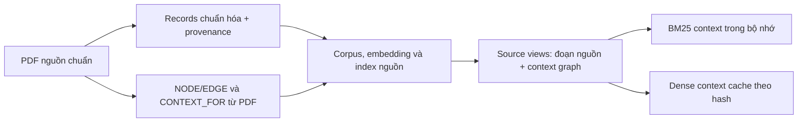
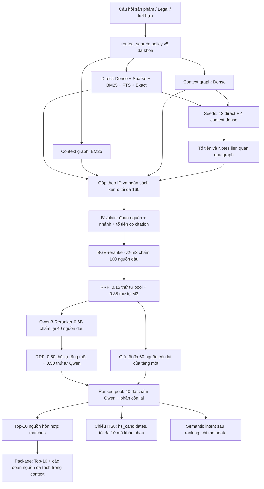

# Retrieval Workflow

## 1. Tổng quan luồng Retrieval

Câu hỏi sản phẩm, pháp lý hoặc kết hợp cả hai đi qua một luồng chung: tìm ứng viên trên bản ghi nguồn và context từ graph → hợp nhất theo ID nguồn → cascade reranker → trả nguồn hỗn hợp, shortlist HS8 và gói chứng cứ.

| Thành phần | Cách hoạt động |
|---|---|
| Bản ghi nguồn | Dòng biểu thuế HS4/HS6/HS8, Notes, GIR và điều khoản |
| Context graph | Đoạn nguồn cùng nhãn trung gian và tổ tiên lấy qua NODE/EDGE |
| Kênh truy xuất | Direct, context BM25, context dense và nguồn liên quan qua graph |
| Khử trùng pool | Bỏ **ID nguồn** trùng; giữ các nguồn khác ID dù cùng mã hoặc không có mã |
| Candidate pool | Tối đa **160 nguồn** |
| Reranker | **M3 chấm 100 → Qwen chấm lại 40** |
| Kết hợp thứ hạng | RRF ở cả hai tầng cascade |
| Đầu ra | Top-10 nguồn hỗn hợp + shortlist HS8 + package nguồn |
| Notes | Tham gia pool/ranking dưới dạng nguồn độc lập; B1 không nối thêm Note liên quan vào text mã |
| Hỏi thêm | Chưa tự xác định thuộc tính thiếu hoặc sinh câu hỏi bổ sung |

Cross-Encoder đọc đồng thời câu hỏi và context ứng viên để chấm mức liên quan; trọng số mô hình không được học lại từ câu hỏi đang nhập. [Sentence Transformers: Retrieve & Re-Rank](https://www.sbert.net/examples/sentence_transformer/applications/retrieve_rerank/README.html).

## 2. Biểu diễn dữ liệu và chuẩn bị index

### 2.1. Bản ghi nguồn

Mỗi đoạn có `id`, `source_text`, `embedding_text`, `chunk_type`, `locator` và metadata. `source_text` là nội dung đoạn nguồn; `embedding_text` là biểu diễn tìm kiếm được chuẩn hóa từ nguồn. Không đồng nhất mọi passage tìm kiếm với nguyên văn PDF hoặc mọi nhãn điều hướng với căn cứ pháp lý.

Luồng chung tìm trên tám loại nguồn:

| `chunk_type` | Nội dung |
|---|---|
| `tariff_entry` | Dòng biểu thuế ở các mức HS đã đăng ký |
| `section_note` | Chú giải Phần |
| `chapter_note` | Chú giải Chương |
| `subheading_note` | Chú giải phân nhóm |
| `tariff_footnote` | Chú thích biểu thuế |
| `gir_rule` | Quy tắc GIR |
| `gir_explanation` | Giải thích GIR |
| `legal_clause` | Điều khoản pháp lý |

`intent="knowledge"` trong bước tìm kiếm chỉ phạm vi toàn nguồn. Auto không đặt bộ lọc Phần/Chương hoặc chọn pool HS/Legal bằng keyword. Corpus chỉ gồm nguồn đã đăng ký, không phải mọi tài liệu bên ngoài hệ thống.

### 2.2. Context từ NODE/EDGE

`GraphContext` dựng một biểu diễn khác cho cùng ID: đoạn nguồn + nhãn trung gian + tổ tiên có thể trích dẫn. Các quan hệ được sử dụng:

| Quan hệ | Cách dùng |
|---|---|
| `CONTAINS` | Đi lên tổ tiên, giới hạn độ sâu 12 |
| `CONTEXT_FOR` | Lấy nhãn không mang mã, có phạm vi xuất tường minh từ cấu trúc PDF |
| `APPLIES_TO`, `APPLIES_WITHIN`, `GOVERNS`, `DEFINES_FOR`, `DEFINITION_APPLIES_TO`, `INCLUDES_IN_SCOPE`, `DEFINES_SCOPE_OF` | Tìm Note theo chiều Note → phạm vi |
| `CONSTRAINED_BY`, `GOVERNED_BY`, `HAS_LEGAL_NOTE`, `SUBJECT_TO` | Tìm Note theo chiều phạm vi → Note |

Cạnh graph chỉ thể hiện quan hệ nguồn; không tự chứng minh Note áp dụng cho sản phẩm đang hỏi. Code không duyệt/diễn giải toàn bộ các quan hệ tham chiếu, ví dụ không thực thi đầy đủ `REFERS_TO`, GIR và điều kiện loại trừ.

Ví dụ đã đối chiếu trong corpus khóa:

| ID | Mô tả dòng mã | Nhãn nhánh |
|---|---|---|
| `tt31:HS8:71012100` | Chưa được gia công | Ngọc trai nuôi cấy |
| `tt31:HS8:71012200` | Đã gia công | Ngọc trai nuôi cấy |

Nhãn lấy từ graph; không có quy tắc “ngọc trai đã gia công → 71012200”. Context làm rõ nguồn nhưng không bảo đảm model luôn xếp đúng.

### 2.3. Chuẩn bị trước truy xuất



PDF là căn cứ xác lập nhãn/phạm vi; pipeline không đọc DOCX để quyết định nhánh. Graph, provenance và nhật ký sửa wording được tạo ở bước build/audit, không từ đáp án benchmark và không đọc lại PDF cho mỗi truy vấn.

Index/embedding nguồn có từ ingestion. BM25 context được dựng trong bộ nhớ khi `UnifiedRetrieval` khởi tạo lần đầu trên một `Retriever`. Dense context dùng cache tại `artifacts/context_embeddings`, theo snapshot, embedding profile, ID và hash text; thiếu cache thì tính lại. “Context được lập index trước” nghĩa là trước bước tìm kiếm, không phải luôn có một index graph độc lập đã lưu sẵn trong vector DB.

Dev/Test không vào corpus/index. Embedding và reranker không fine-tune; Dev chọn cấu hình, Test chấm sau khi khóa.

## 3. Sơ đồ xử lý câu hỏi v5



Đây là các kênh logic; code không bảo đảm chúng chạy đồng thời. HS và Legal dùng cùng trọng số/ngân sách.

## 4. Truy xuất và gộp ứng viên

### Bước 1 — Kiểm tra policy

Caller dùng `Retriever.routed_search(query)` với `Embedder`. `intent=auto/product/qa` chỉ được ghi thành hint, không đổi pool/ranking. `mode` phải là `None` hoặc `full_hybrid`.

Runtime kiểm tra snapshot/profile nguồn, query embedder, retrieval settings, model revision, instruction và ngân sách token so với lock. Thiếu policy hoặc sai ràng buộc thì báo lỗi; Auto không tự dùng router từ khóa/cấu hình khác làm fallback.

### Bước 2 — Direct trên bản ghi nguồn

| Kênh | Ý nghĩa | Trọng số |
|---|---|---:|
| Dense | Vector ngữ nghĩa BGE-M3 | 0.35 |
| Sparse | Biểu diễn từ vựng sparse BGE-M3 | 0.15 |
| BM25 | Xếp hạng từ vựng | 0.35 |
| FTS | PostgreSQL full-text search | 0.05 |
| Exact | Các dấu hiệu exact được bộ tìm kiếm hỗ trợ | 0.10 |

Kết hợp năm kênh bằng Reciprocal Rank Fusion (RRF), `k=60`, lấy tối đa 160 ID. Không cộng trực tiếp cosine, BM25 và logits vì khác thang điểm.

Vẫn có parser/regex tổng quát: `code_mention_plan` nhận ra mã trong câu và che mã bị phủ định/nghi vấn **chỉ cho Exact**. Các kênh khác vẫn đọc câu gốc. Đây không phải suy luận pháp lý để loại mã, bảng keyword → mã đúng hoặc router HS/Legal.

### Bước 3 — Context BM25 và dense

- `context_lex`: BM25 trên source views, tối đa 160 ID.
- `context_dense`: tích vô hướng vector câu hỏi/context, tối đa 160 ID.

Text lập vector context được fit theo tokenizer/ngân sách embedding. Context reranker được chuẩn bị lại từ nguồn/citation với ngân sách riêng.

### Bước 4 — Neighbors từ graph

Lấy tối đa 12 ID đầu `direct` và 4 ID đầu `context_dense` làm seeds. Lấy tổ tiên và `note_ids` liên kết; chỉ ID có bản ghi/source view thật vào kênh. Xếp theo điểm context dense và ID, tối đa 160 nguồn.

Không có danh sách ứng viên riêng theo Chương, không gán loại sản phẩm bằng chữ số mã và không thực thi luật loại trừ tại bước này.

### Bước 5 — Pool theo ID và ngân sách

| Kênh pool | Tỷ lệ |
|---|---:|
| Direct | 0.650 |
| Context BM25 | 0.125 |
| Context dense | 0.125 |
| Neighbors | 0.100 |

`id_pool` phân bổ cơ hội tuyển chọn trong các prefix khi mỗi kênh còn nguồn. Đây không phải quota cứng luôn đủ đúng số lượng. ID đã lấy không lấy lại; pool có thể ít hơn 160.

Giữ các đoạn khác ID dù cùng mã hoặc `code=None`. Một mã có thể có dòng biểu thuế và nhiều Notes; GIR/điều khoản có thể không có mã. Khử trùng theo mã trong pool sẽ làm mất chứng cứ.

## 5. Context reranker và vai trò Notes

### B1/plain đang chọn

Text ứng viên gồm biểu diễn đoạn nguồn, nhãn nhánh và tổ tiên có thể trích dẫn. Khử văn bản trùng, giữ citation/ID. Ưu tiên nhãn trung gian và tổ tiên gần trong ngân sách hierarchy 5.000 ký tự. Ngân sách Note 1.500 ký tự chỉ dùng khi chọn B2.

Sau đó fit token theo model:

- M3: tối đa 2.048 token cho cặp query/context.
- Qwen: fit 1.840 token để dành chỗ cho template/instruction trong giới hạn backend 2.048.
- Nếu quá dài: bỏ **nguyên citation tùy chọn**, ghi ID đã bỏ; không cắt âm thầm câu hỏi/đoạn nguồn bắt buộc. Nếu hai phần bắt buộc vẫn vượt ngân sách thì báo lỗi.
- Node ảo/điều hướng vẫn đi qua trong graph nhưng không được trích thành wording pháp lý nếu không đủ căn cứ nguồn.

### Hai cơ chế Notes khác nhau

1. **Note là bản ghi ứng viên:** direct/context/neighbors có thể tìm Note trước rerank. M3/Qwen chấm Note độc lập; Note cạnh tranh vị trí và ngân sách với dòng biểu thuế, kể cả B1.
2. **Nối Note liên quan vào text mã:** B2 mới làm việc này. Note phải có cạnh graph và được tìm trong kênh direct; vẫn cần đối chiếu áp dụng. V5 đang chọn B1 nên không bật cơ chế nối này.

Trong B1, Notes tham gia pool/ranking dưới dạng đoạn nguồn độc lập. Context của từng mã gồm đoạn nguồn và hierarchy; không nối thêm các Notes liên quan vào passage của mã.

## 6. Cascade M3 → Qwen

### Tầng một

Lấy 100 nguồn đầu pool, chấm `query + context` bằng `BAAI/bge-reranker-v2-m3`. Kết hợp thứ tự pool với thứ tự M3:

```text
score1(ID) = 0.15 / (60 + rank_pool(ID))
           + 0.85 / (60 + rank_M3(ID))
```

`rank_pool` là thứ tự sau phân bổ kênh, không phải raw similarity. 60 ứng viên cuối pool 160 không được chấm Cross-Encoder và không vào `ranked_pool` trong cấu hình này.

### Tầng hai

Lấy 40 nguồn đầu sau tầng một, lấy lại context gốc và fit riêng cho Qwen; không dùng mặc định context đã rút ngắn cho M3. Qwen có instruction dùng chung cho sản phẩm/pháp lý, không giả định thuộc tính chưa nêu; backend chấm yes/no theo [Qwen model card](https://huggingface.co/Qwen/Qwen3-Reranker-0.6B).

```text
score2(ID) = 0.50 / (60 + rank_stage1_within_top40(ID))
           + 0.50 / (60 + rank_Qwen(ID))
```

Ghép 40 nguồn theo thứ tự mới với tối đa 60 nguồn còn lại của tầng một. Không chấm Qwen cả 160 nguồn hoặc trộn raw logits M3/Qwen để xếp toàn danh sách. Rerank score đo liên quan, không phải xác suất đã hiệu chuẩn mã đúng/căn cứ đã đủ.

Gemma được chấm trong thực nghiệm Dev. Cascade phục vụ sử dụng BGE-reranker-v2-m3 và Qwen3-Reranker-0.6B.

## 7. Đầu ra và cách sử dụng

| Trường | Nội dung | Lưu ý |
|---|---|---|
| `matches` | Tối đa 10 ID nguồn đầu | Hỗn hợp HS4/HS6/HS8, Notes, GIR, điều khoản |
| `ranked_pool` | Tối đa 100 nguồn qua tầng một; Top-40 qua Qwen | Thứ tự chung sau cascade |
| `candidate_pool` | Tối đa 160 nguồn đã tuyển/chuẩn bị context | Không phải tất cả đã rerank |
| `hs_candidates` | Tối đa 10 mã HS8 khác nhau, chiếu từ **toàn ranked pool** | Chỉ `tariff_entry`, `level=8` |
| `candidates` | Cùng shortlist HS8 | Alias của `hs_candidates` |
| `package` / `evidence.records` | `matches` + bản ghi thật của citation trong context | Có thể hơn 10; không phải Top-10 ranking |
| `semantic_intent` | Nhận diện tác vụ sau ranking | `used_for_retrieval=False` |
| `automatic_hs_decision` | `False` | Chưa quyết định mã cuối |
| `snapshot`, `profile`, `policy_hash`, `timings` | Ràng buộc nguồn/cấu hình, thời gian | Phục vụ truy vết |

`hs_candidates` không chỉ lọc 10 phần tử `matches`: mã ở vị trí 20 toàn nguồn vẫn có thể nằm trong shortlist HS8. Không gọi điểm shortlist HS là điểm danh sách hỗn hợp.

`source_package` không tìm thêm Notes sau ranking hoặc materialize mọi `note_ids`. Nó bổ sung bản ghi thật của citation đã giữ trong context. ID Note có trong metadata không đồng nghĩa text Note đã được đọc/áp dụng hoặc nằm trong package.

```python
from rag.db import connect
from rag.embedding import Embedder
from rag.retrieval import Retriever

with connect() as conn:
    retriever = Retriever(conn, Embedder())
    result = retriever.routed_search("Ngọc trai nuôi cấy đã được gia công")
    sources = result["matches"]
    hs_shortlist = result["hs_candidates"]
    cited_source_package = result["package"]
```

Caller dùng shortlist và nguồn cho bước đối chiếu/trả lời. Retrieval chưa phải bộ sinh câu trả lời hoàn chỉnh.

## 8. Semantic intent và hỏi thêm

Logistic regression dùng vector câu hỏi BGE-M3; fit trên Dev, chọn `C=10` bằng folds giữ nhóm. Tính sau ranking:

- `p_legal`, `p_product`: xác suất nhận diện tác vụ, không phải độ chắc chắn đáp án.
- `p_legal` trong 0.4–0.6: `mixed_or_uncertain`; trên 0.6: `qa`; dưới 0.4: `product`.
- Metadata không đổi pool, trọng số, model hay ranking. Câu mới vẫn tìm cùng corpus dù intent dự đoán sai.

Luồng hiện tại trả shortlist và citation để caller đối chiếu nguồn. Hệ thống chưa tự xác định thuộc tính thiếu, sinh câu hỏi bổ sung hoặc thực thi đầy đủ GIR để chọn mã cuối.

## 9. Cấu hình hiệu lực và nền

| Thông số v5 | Giá trị |
|---|---|
| Snapshot | `a6717fc579f18c7a1dbac656` |
| Embedding profile | `3a2ce6e6d726a0f053748717` |
| Context | B1/plain |
| Candidate pool | 160 |
| M3 pool / rank weight | 100 / 0.85 |
| Qwen pool / cascade weight | 40 / 0.50 |
| RRF k | 60 |
| Direct Dense/Sparse/BM25/FTS/Exact | 0.35 / 0.15 / 0.35 / 0.05 / 0.10 |
| Pool direct/lex/dense/neighbors | 0.65 / 0.125 / 0.125 / 0.10 |

`rag.yaml` và khối `retrieval_config` vẫn có mặc định nền pool 50/rerank 30. Khối này cần khớp để tái lập cấu hình nền; không có nghĩa Auto v5 chạy pool 50/30. Luồng chung dùng 160/100/40 ở cấp policy, truyền `top_k=160` cho truy xuất trực tiếp.

`Retriever.__init__` vẫn đọc `selected_retrieval.json` và `hybrid_retrieval.json` khi khởi tạo backend. Tham số tuyển chọn, cascade và trọng số của luồng chung lấy từ `unified_retrieval.json`.

## 10. Thêm Chương mới

1. Bổ sung PDF, records/NODE/EDGE cùng schema và đăng ký source manifest.
2. Audit ID, cạnh, citation và phạm vi nhãn trung gian.
3. Ingest snapshot mới; dựng source views/embedding/index theo nguồn mới.
4. Kiểm chứng/chọn policy trên Dev, khóa đúng snapshot/profile mới và kích hoạt.

Không cần thêm `if chapter == ...` hoặc keyword → mã. Nhưng policy khóa snapshot không tự hợp lệ khi thay nguồn; cùng thuật toán không bảo đảm cùng chất lượng khi wording/loại sản phẩm đổi. Điểm XIV/XVI/XVII chưa chứng minh chất lượng mọi Chương mới.

## 11. Kết quả và giới hạn đã đo

[Báo cáo v5](../artifacts/experiments/run_unified_accuracy_v5/IMPLEMENTATION_REPORT_V5.md): chọn trên 752 HS + 520 Legal Dev; chấm sau khóa trên 188 HS + 130 Legal Test.

| Test HS shortlist | N | Hit@1 | Recall@5 | Recall@10 | MRR@10 |
|---|---:|---:|---:|---:|---:|
| XIV | 49 | 51.0% | 91.8% | 98.0% | 0.6938 |
| XVI | 85 | 81.2% | 94.1% | 98.8% | 0.8696 |
| XVII | 54 | 63.0% | 83.3% | 94.4% | 0.7286 |
| Toàn HS | 188 | 68.1% | 90.4% | 97.3% | 0.7833 |

Legal đủ mọi nhóm nguồn sơ cấp Top-10: 121/130 (93.1%); package đủ nhóm: 123/130 (94.6%). Đây là phủ chứng cứ, không phải độ đúng câu trả lời chatbot. HS trên nguồn hỗn hợp: Hit@1 62.8%, Recall@10 93.6%, khác shortlist.

XIV đạt Hit@1 51.0%, nên vẫn cần đối chiếu nguồn khi lựa chọn mã. Test đã từng được xem, là bằng chứng hồi quy và chưa chứng minh chất lượng trên Chương mới. Dữ liệu Test chỉ dùng chấm sau khi khóa policy.

Hồ sơ v5 ghi nhận 104 tests passed, runtime/replay khớp 6 câu với ba hint, Ruff/format/mypy đạt. Đây là lượt đã hoàn tất; chỉnh tài liệu không tạo một lượt đo mới.

## 12. Vai trò các nhóm file

| Nhóm file | Vai trò |
|---|---|
| `rag/unified.py`, `context.py`, `retrieval.py`, `embedding.py` | Runtime, context graph, tuyển ứng viên, cascade và cache |
| `config/unified_retrieval.json`, `semantic_intent.json` | Policy chung và artifact intent được khóa hash |
| `rag/pdf_graph.py`, `scripts/build_pdf_graph.py`, `audit_pdf_sources.py`, `ocr_pdf.swift` | Trích xuất/audit PDF và OCR nguồn scan |
| PDF, NODE/EDGE, `PDF_SOURCE_GRAPH.json`, `PDF_SOURCE_PROVENANCE.json`, `PDF_SOURCE_TEXT_CORRECTIONS.json` | Căn cứ nguồn, provenance và tái dựng graph |
| `scripts/benchmark_unified_retrieval.py`, `tests/` | Chọn cấu hình trên Dev, chấm Test và kiểm chứng cơ chế |
| Pools, score matrices, predictions, protocol và report trong `artifacts/experiments/run_unified_accuracy_v5/` | Tái lập selection/replay; `dev_pools.sqlite` là pool thực nghiệm, không phải vector DB phục vụ |
| `supporting/SECTION_XVII_BENCHMARK_FINAL_CORRECTIONS.json` | Nhật ký wording PDF được records/master tham chiếu, giữ provenance |

Công cụ build/audit/benchmark chạy khi chuẩn bị nguồn hoặc thực nghiệm; không chạy lại cho mỗi câu hỏi.

## 13. Tham chiếu implementation

- [retrieval.py](../rag/retrieval.py): `Retriever.__init__`, `routed_search`, `unified_search`.
- [unified.py](../rag/unified.py): `channels`, `id_pool`, `prepare`, `rank_scores`, `rank`, `hs_projection`, `source_package`, `semantic_intent`, `search`.
- [context.py](../rag/context.py): `GraphContext`, `source_view`, `enrich`, `format_candidates`, `fit_rerank_context`.
- [embedding.py](../rag/embedding.py): context vectors, `CrossEncoder`, instruction/backend/cache.
- [benchmark_unified_retrieval.py](../scripts/benchmark_unified_retrieval.py): protocol, Dev, cascade, lock, Test, bootstrap và kiểm chứng.
- [README-RAG.md](../README-RAG.md): môi trường, dữ liệu và kết quả hiện tại.
