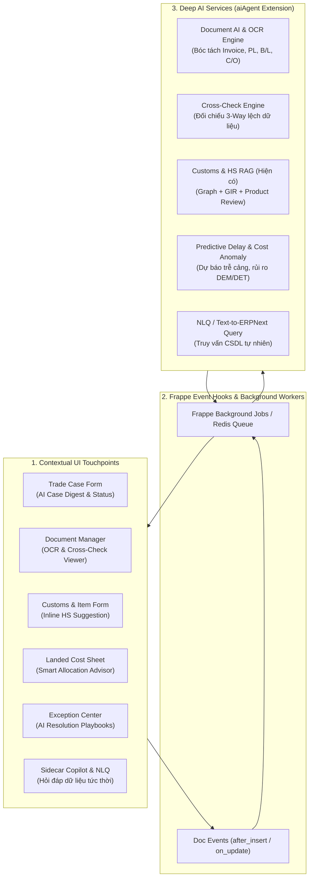

### BÁO CÁO NGHIÊN CỨU & THIẾT KẾ KIẾN TRÚC: NHÚNG SÂU AI VÀO TOÀN BỘ HỆ THỐNG XUẤT NHẬP KHẨU

Chào bạn, qua khảo sát chi tiết cấu trúc mã nguồn hiện tại của dự án:
1. **Lớp Nghiệp vụ ERP lõi & Vận hành Global Trade (`logistics_wizard`)**: Đã có nền tảng vững chắc với 7 module (`Trade Case`, `Shipment Tracking & Control Tower`, `Trade Documents`, `Customs & Compliance`, `Trade Cost & Landed Cost`, `Exception/Workflow`, `Dashboard/Reporting`).
2. **Lớp AI/RAG Chuyên sâu (`aiAgent`)**: Đã sở hữu một động cơ RAG cực kỳ tinh vi về pháp lý Hải quan Việt Nam (Nghị định, Thông tư 31, Thông tư 85, 6 quy tắc GIR, Graph ngữ nghĩa, cơ chế kiểm duyệt Product Review và phân giải đa mục tiêu `goals-v1`).
3. **Thực trạng liên kết**: AI hiện tại vẫn đang vận hành **độc lập** (chủ yếu chạy qua CLI/Notebook hoặc demo mock ở trang `logistics_ai_chatbot`). Người dùng vẫn phải chủ động mở chatbot để hỏi — đây là mô hình **"AI nông" (Shallow AI)**.

Để **"nhúng sâu" (Deeply Embedded AI)**, AI không thể chỉ là một hộp chat bên lề, mà phải trở thành **bộ não đồng hành (Co-pilot & Autonomous Agents)** can thiệp trực tiếp vào từng vòng đời chứng từ, bắt sự kiện (Doc Events Hooks), xử lý ngầm (Background Jobs) và hỗ trợ ra quyết định tại chỗ trên từng Form nghiệp vụ.

---

### PHẦN 1: BẢN ĐỒ NHÚNG SÂU AI THEO 7 MODULE NGHIỆP VỤ



---

#### 1. Module Trade Case Management (Hồ sơ trung tâm)
* **Thực trạng**: Quản lý vòng đời `IMP-xxxx` / `EXP-xxxx`, liên kết PO/SO, Shipment, Costs, Status.
* **Cách nhúng sâu AI**:
  - **Tự động trích xuất lập hồ sơ (Smart Case Onboarding)**: Nhân viên chỉ cần kéo thả hợp đồng ngoại thương (Sales Contract / PO), AI tự động đọc và điền trước (pre-fill) thông tin: Đối tác, Điều kiện Incoterms, Cảng xếp/dỡ (POL/POD), Phương thức thanh toán, Danh mục hàng hóa dự kiến.
  - **Trợ lý tóm tắt điều hành (Executive Case Digest)**: Tại đầu mỗi hồ sơ Trade Case, AI tự động sinh một khối tóm tắt động: *"Lô hàng IMP-2026-001 đang ở bước Hải quan; Tàu đã cập cảng Cát Lái sớm 1 ngày; Đang thiếu bản gốc C/O Form E; Dự toán chi phí đang tăng 4.2% do phụ phí lưu bãi"*.

#### 2. Module Shipment Tracking & Control Tower (Theo dõi hành trình)
* **Thực trạng**: Nhận tọa độ/sự kiện từ AfterShip, tính toán hải trình, tính toán chậm trễ (`delay_engine.py`).
* **Cách nhúng sâu AI**:
  - **Dự báo trễ chuyến thông minh (Predictive Delay AI)**: Kết hợp dữ liệu lịch trình tàu với tình trạng tắc nghẽn cảng biển quốc tế và yếu tố thời tiết để đưa ra cảnh báo sớm: *"Tuyến Thượng Hải -> Hải Phòng qua tàu X có nguy cơ trễ 2-3 ngày tại điểm chuyển tải do thời tiết, khuyến nghị dời lịch kiểm hóa"*.
  - **Giám sát rủi ro Demurrage & Detention (Free-time Guardian)**: AI tính toán thời gian hàng nằm tại bãi (Yard Dwelling Time) so với số ngày miễn phí cược bãi/vỏ cont (Free-time) của hãng tàu, tự động kích hoạt cảnh báo rủi ro phát sinh chi phí phạt trước 48h.

#### 3. Module Trade Document Management (Quản lý chứng từ)
* **Thực trạng**: Danh mục checklist (Invoice, Packing List, B/L, C/O, Tờ khai), trạng thái thủ công.
* **Cách nhúng sâu AI**:
  - **Document OCR & Entity Extraction**: Tự động bóc tách số liệu bảng kê từ file PDF/ảnh scan của Commercial Invoice, Packing List, B/L (tên hàng, số kiện, Net Weight, Gross Weight, Volume CBM, số container, số seal).
  - **Đối chiếu chéo tự động (3-Way Cross-checking Agent)**: Tự động so khớp chéo 3 bên giữa: **PO vs Invoice vs Packing List vs B/L**. Phát hiện tức thì các sai lệch nguy hiểm (Ví dụ: Trọng lượng trên B/L lệch 50kg so với Packing List; tên hàng trên Invoice khác với mô tả đăng ký kiểm tra chất lượng).
  - **Gợi ý bộ hồ sơ bắt buộc theo Incoterms & Mặt hàng**: AI nhận diện mặt hàng và điều kiện giao hàng để cảnh báo thiếu chứng từ (Ví dụ: Nhập gỗ cần Phytosanitary Certificate, nhập thịt cần Health Certificate, Incoterms CIF bắt buộc có Insurance Policy).

#### 4. Module Customs & Trade Compliance (Hải quan & Tuân thủ - Thế mạnh cốt lõi)
* **Thực trạng**: `aiAgent` đang có kiến trúc RAG biểu thuế cực mạnh, nhưng đang tách biệt với Form nghiệp vụ.
* **Cách nhúng sâu AI**:
  - **Inline HS Assistant ngay trên bảng hàng hóa (Item Table)**: Ngay tại bảng hàng hóa của `Trade Case` hoặc `Item Master`, người dùng nhấn **"AI Gợi ý mã HS"** -> Hệ thống gửi thông số kỹ thuật sang `aiAgent`, trả về mã 8 số kèm căn cứ phân loại (GIR, trích lục chú giải) và mức độ đảm bảo pháp lý.
  - **Cơ chế Kiểm soát chính sách mặt hàng & Giấy phép tự động**: AI đối chiếu mã HS với cơ sở dữ liệu pháp luật để cảnh báo ngay: Mặt hàng có cần xin giấy phép nhập khẩu tự động? Có chịu thuế chống bán phá giá? Có thuộc danh mục kiểm tra chuyên ngành của bộ nào không?
  - **Soạn thảo mô tả hàng hóa chuẩn Hải quan (Customs Declaration Draft)**: Chuyển tên thương mại thông thường thành tên khai báo hải quan đạt chuẩn: *[Tên hàng] + [Thành phần cấu tạo] + [Công dụng] + [Model/Quy cách]* để hạn chế tối đa việc bị công chức hải quan chất vấn hoặc phân luồng Đỏ.

#### 5. Module Trade Cost & Landed Cost Management (Chi phí & Giá vốn)
* **Thực trạng**: Tập hợp chi phí thực tế, có `allocation_engine.py` phân bổ theo Value/Weight/Volume và đẩy vào `ERPNext Landed Cost Voucher`.
* **Cách nhúng sâu AI**:
  - **Trích xuất hóa đơn chi phí (Cost Invoice Parser)**: Kế toán nhận hóa đơn cước tàu, nâng hạ cảng, vận chuyển nội địa (Trucking) -> AI đọc hóa đơn, tự động nhận diện `Cost Type` và tạo các dòng `Trade Cost Item` tương ứng vào đúng Trade Case.
  - **Tư vấn quy tắc phân bổ tối ưu (Smart Allocation Advisor)**: Dựa vào cơ cấu mặt hàng trong lô (hàng nặng chiếm ít chỗ vs hàng cồng kềnh nhẹ), AI tư vấn nên phân bổ cước biển theo `Gross Weight` hay `Volume`, phân bổ bảo hiểm theo `Value` để giá vốn phản ánh trung thực nhất biên lợi nhuận.
  - **Phát hiện phương sai & bất thường chi phí (Cost Anomaly Detection)**: Tự động so sánh `Actual Cost` với `Estimated Cost`. Cảnh báo ngay khi một dòng chi phí vượt ngưỡng (ví dụ: Local charges tăng bất thường 35% so với báo giá hợp đồng).

#### 6. Module Exception / Workflow / Action Management (Sự cố & Xử lý)
* **Thực trạng**: Định nghĩa rules delay, thiếu chứng từ, vượt chi phí.
* **Cách nhúng sâu AI**:
  - **Tự động sinh Exception theo ngữ cảnh**: Không chỉ dựa vào các điều kiện cứng `if/else`, AI đánh giá mức độ nghiêm trọng tổng thể của sự cố để mở bản ghi `Shipment Exception`.
  - **Đề xuất sổ tay xử lý sự cố (AI Resolution Playbook)**: Khi có exception (Ví dụ: *"Hàng bị giữ tại kiểm hóa Hải quan"*, *"C/O bị Hải quan từ chối vì sai tiêu chí xuất xứ"*), AI đề xuất ngay các bước xử lý cụ thể, căn cứ quy định giải trình và soạn thảo sẵn văn bản/email gửi đối tác hoặc cơ quan hải quan.

#### 7. Module Dashboard / Reporting & NLQ (Báo cáo & Giám sát)
* **Thực trạng**: Các dashboard số liệu cố định trên desk.
* **Cách nhúng sâu AI**:
  - **Truy vấn dữ liệu bằng ngôn ngữ tự nhiên (Natural Language Query / Text-to-ERPNext)**: Người quản lý chỉ cần hỏi trong chatbot hoặc thanh tìm kiếm:
    - *"Tổng chi phí phát sinh cho các lô hàng nhập từ Nhật Bản trong tháng này là bao nhiêu?"*
    - *"Liệt kê các lô hàng đang bị trễ quá 3 ngày và nguyên nhân chính là gì?"*
    AI tự động dịch câu hỏi thành truy vấn Frappe ORM/SQL an toàn, lấy dữ liệu và hiển thị bảng biểu/biểu đồ tương tác trực tiếp.

---

### PHẦN 2: KIẾN TRÚC KỸ THUẬT NHÚNG SÂU (TECHNICAL INTEGRATION)

Để kết nối mượt mà giữa ứng dụng Python của Frappe (`logistics_wizard`) và động cơ AI (`aiAgent`), chúng ta thiết lập mô hình tích hợp 3 tầng:

```
┌────────────────────────────────────────────────────────────────────────┐
│                   FRAPPE FRAMEWORK (Desk UI & API)                     │
│  - Form Scripts: Nút bấm AI Assist trên Item, Trade Case, Cost Sheet   │
│  - Doc Events Hooks: Tự động kích hoạt khi có chứng từ/sự kiện mới     │
│  - Sidecar Copilot: Ngăn trợ lý bên phải (Context-aware per Document)   │
└───────────────────────────────────┬────────────────────────────────────┘
                                    │ (Frappe Background Jobs / REST)
                                    ▼
┌────────────────────────────────────────────────────────────────────────┐
│             LOGISTICS AI GATEWAY & WORKER (Internal API)               │
│  - FastAPI / Frappe Whitelisted Endpoints                              │
│  - Task Dispatcher (HS Classification, Doc OCR, Cost Parser, NLQ)      │
│  - Cache Layer (Redis): Lưu context phiên làm việc và kết quả tra cứu │
└───────────────────────────────────┬────────────────────────────────────┘
                                    │
                                    ▼
┌────────────────────────────────────────────────────────────────────────┐
│                  AI AGENT CORE ENGINE (aiAgent)                        │
│  - Customs RAG Engine (TT31, TT85, GIR Rules, Graph Search, Reviewers) │
│  - Multimodal Vision / OCR Engine (Document Extraction)                │
│  - LLM Reasoning & Function Calling (Gemini / Local Models)           │
└────────────────────────────────────────────────────────────────────────┘
```

1. **Context-Aware Sidecar Copilot**:
   Thay vì chatbot chung chung, khi người dùng mở bất kỳ DocType nào (ví dụ: `Trade Case IMP-2026-001`), Sidebar Copilot tự động nạp toàn bộ dữ liệu của hồ sơ đó vào context. Người dùng có thể ra lệnh: *"Kiểm tra xem lô này còn thiếu giấy tờ gì?"*, *"Dự thảo email cho forwarder đòi B/L gốc"*.
2. **Frappe Doc Events Hooks**:
   Trong `hooks.py` của `logistics_wizard`, đăng ký các sự kiện ngầm:
   - `Trade Document.after_insert`: Đẩy tác vụ OCR và đối chiếu chéo vào Redis Queue.
   - `Shipment Tracking.on_update`: Đẩy tác vụ phân tích rủi ro trễ vào hàng đợi nền.
3. **Internal Microservice Contract**:
   Đóng gói `aiAgent` thành một dịch vụ nội bộ có API chuẩn hóa (FastAPI hoặc module gọi trực tiếp), phản hồi dưới dạng structured JSON có schema xác thực rõ ràng.

---

### PHẦN 3: LỘ TRÌNH TRIỂN KHAI THEO GIAI ĐOẠN (ROADMAP)

* **Giai đoạn 1: Khai thác ngay thế mạnh cốt lõi (Quick Wins - Customs & Compliance)**
  - Tích hợp động cơ RAG của `aiAgent` trực tiếp vào `Item` và `Trade Case Items`.
  - Thêm nút *"Gợi ý mã HS & Thuế"* ngay trên giao diện form.
  - Hoàn thiện tính năng Copilot ngữ cảnh (Context-aware Sidecar) trên `Trade Case Overview`.

* **Giai đoạn 2: Tự động hóa chứng từ & Đối chiếu dữ liệu (Document Intelligence)**
  - Tích hợp bộ bóc tách chứng từ (Document AI/OCR) cho Commercial Invoice, Packing List và B/L.
  - Xây dựng động cơ đối chiếu 3 chiều (3-Way Cross-check) phát hiện sai lệch số liệu.

* **Giai đoạn 3: Tự động hóa chi phí & Động cơ phân bổ thông minh (Cost & Landed Cost AI)**
  - Nhập liệu chi phí tự động từ hóa đơn dịch vụ logistics/cảng.
  - AI gợi ý quy tắc phân bổ Landed Cost và phát hiện biến động chi phí.

* **Giai đoạn 4: Quản trị dự báo & Giám sát thông minh (Control Tower & NLQ Agent)**
  - Dự báo trễ chuyến và cảnh báo rủi ro phí phạt lưu bãi (DEM/DET).
  - Tích hợp truy vấn báo cáo bằng ngôn ngữ tự nhiên (NLQ).

---
